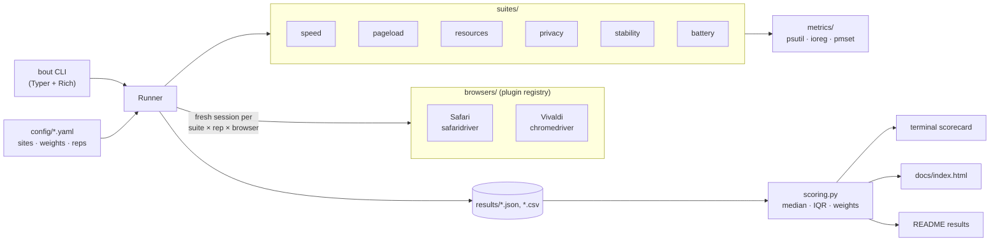

# 🥊 BrowserBout

[](https://github.com/MS-Teja/BrowserBout/actions/workflows/ci.yml)


**Automated, reproducible head-to-head browser benchmarks for macOS.**
Which browser is actually better on *my* Mac: Safari or Vivaldi? Instead of opinions, BrowserBout drives
both browsers with Selenium through the same workloads (industry benchmarks, real websites, memory and CPU,
privacy, stability under stress and battery drain), then scores them and declares a winner.

<!-- BOUT:START -->
### Latest results — 2026-10-16

_Full run on Mac17,5 (Apple A18 Pro, 8 GB), macOS 27.0.1, battery power._

**🏆 Overall winner: Safari**

| Category | Weight | Safari 27.0.1 | Vivaldi 8.2.4133.87 | Winner |
|---|---|---|---|---|
| Speed | 36% | 92.1 | **99.5** | Vivaldi |
| Page loads | 29% | **99.0** | 65.6 | Safari |
| Resource usage | 21% | **100.0** | 64.6 | Safari |
| Privacy | 14% | **100.0** | 53.9 | Safari |
| **Overall** | | **96.9** | 75.8 | **🏆 Safari** |

<details><summary>All metrics</summary>

| Category | Metric | Safari | Vivaldi |
|---|---|---|---|
| Speed | Speedometer 3.1 (web app responsiveness) ↑ | 45.1 score ±0.32 | **50.8 score ±0.05** |
| Speed | JetStream 2.2 (JavaScript & WebAssembly) ↑ | **461 score ±2.93** | 454 score ±2.20 |
| Speed | MotionMark 1.3 (graphics & animation) ↑ | 5,649 score ±71.7 | **6,449 score ±45.7** |
| Page loads | Time to first byte (cold) · 13 sites ↓ | **219 ms ±23.3** | 636 ms |
| Page loads | First contentful paint (cold) · 14 sites ↓ | **651 ms** | 1,461 ms |
| Page loads | Largest contentful paint (cold) · 14 sites ↓ | **884 ms** | 2,196 ms |
| Page loads | DOMContentLoaded (cold) · 14 sites ↓ | **782 ms ±64.8** | 1,951 ms |
| Page loads | Full page load (cold) · 12 sites ↓ | **1,301 ms ±67.5** | 3,850 ms |
| Page loads | First contentful paint (warm) · 13 sites ↓ | **339 ms ±23.3** | 348 ms |
| Page loads | Largest contentful paint (warm) · 13 sites ↓ | 480 ms ±45.1 | **468 ms** |
| Page loads | DOMContentLoaded (warm) · 14 sites ↓ | 367 ms ±37.9 | 368 ms |
| Page loads | Full page load (warm) · 14 sites ↓ | 626 ms ±67.5 | **587 ms** |
| Resource usage | Memory, idle (1 blank tab) ↓ | **954 MB ±473** | 1,124 MB ±62.7 |
| Resource usage | CPU, idle ↓ | **0.20 % core ±0.07** | 0.80 % core ±0.03 |
| Resource usage | Memory with 10 site tabs ↓ | **3,133 MB ±61.6** | 5,060 MB ±579 |
| Resource usage | Background CPU with 10 site tabs ↓ | **7.60 % core ±0.55** | 38.6 % core ±8.57 |
| Resource usage | Memory per extra tab ↓ | **227 MB ±43.4** | 394 MB ±64.2 |
| Resource usage | Processes with 10 tabs ↓ _(info)_ | 28 ±1.75 | 32 ±6 |
| Privacy | Tracker requests (all sites) · 18 sites ↓ | **15 requests** | 150 requests |
| Privacy | Third-party domains contacted (all sites) · 18 sites ↓ | **53 domains ±0.25** | 140 domains |
| Privacy | Fingerprinting surfaces exposed ↓ | **3 surfaces** | 5 surfaces |
| Privacy | Installed fonts visible to pages ↓ | 45 fonts | 45 fonts |
| Stability | Crashes ↓ | 0 | — |
| Stability | Hangs (> 5s unresponsive) ↓ | 13 | — |
| Stability | Tab responsiveness under load (p95) ↓ | 479 ms | — |
| Stability | Time to open a tab under load (median) ↓ | 1.31 s | — |
| Stability | Memory growth over the session ↓ | 0 MB/min | — |
| Stability | Peak memory with 20 tabs ↓ | 2,999 MB | — |
| Battery | Battery drain ↓ | 397 mAh/h | — |
| Battery | Average battery power draw ↓ _(info)_ | 1.35 W | — |
| Battery | Battery used per hour ↓ _(info)_ | 5.65 %/h | — |
| Battery | Estimated battery life for this workload ↑ _(info)_ | 24.5 h | — |

</details>

> ⚠️ Stability not scored: no data for Vivaldi (see errors).

> ⚠️ Battery not scored: no data for Vivaldi (see errors).

Notes: 8 step(s) failed; see the raw results.

📊 **[Interactive dashboard](https://ms-teja.github.io/BrowserBout/)** · raw data: [`results/20261016-214502-full.json`](results/20261016-214502-full.json)
<!-- BOUT:END -->

### About these results

These come from one overnight `--full` run on 2026-10-16 (MacBook with an Apple A18 Pro and 8 GB RAM, unplugged,
clean default profiles). Read them with these caveats in mind:

- **Only 4 of 6 categories are scored.** Vivaldi's stability and battery tests failed partway through, so neither
  category has data for both browsers. The overall score re-weights speed, page loads, resource usage and privacy.
  For reference, Safari alone: **0 crashes and 13 hangs** in a 15-minute, 20-tab stress session, and **397 mAh/hour**
  battery drain (about 24.5 h estimated) in the 30-minute browsing and video loop.
- **The failures came from heavy pages that never finished loading.** On sites like CNN, The Verge, MDN and Twitch,
  Vivaldi sometimes hit the 45-second load limit, and ChromeDriver then stopped responding ("Timed out receiving
  message from renderer"). This run used an early version of BrowserBout that discarded the whole step when that
  happened. Steps lost: Vivaldi page loads 3 of 5 reps, privacy 2 of 3, stability 1 of 1, battery at minute 24 of 30;
  Safari page loads 1 of 5 (Safari hung for 10 minutes on one page).
- **✅ This is fixed.** Since [`7686739`](https://github.com/MS-Teja/BrowserBout/commit/7686739), BrowserBout restarts
  a stuck browser with a fresh profile and carries on instead of discarding the step. A stuck page now counts
  against the browser rather than erasing its data: page loads score "pages that didn't finish loading", and
  stability scores "times the browser stopped responding and was restarted". The next full run should produce
  stability and battery results for both browsers. These published results predate the fix and haven't been re-run.
- **Page-load and privacy numbers only compare sites both browsers loaded**, using every rep that completed. Pages
  that timed out aren't counted against Vivaldi in this run.
- **Memory pressure may have contributed.** Vivaldi used about 5 GB with 10 tabs open on this 8 GB Mac (Safari
  about 3 GB), which can slow page loads and cause timeouts. That is part of the real-world experience on this
  machine, but results on a Mac with more memory may differ.
- **One machine, one night, real websites.** Sites change between runs, so treat small differences as noise. The
  "confidence" column marks metrics where the gap was larger than the run-to-run spread.

## What gets measured

| Category | How | Metrics |
|---|---|---|
| **Speed** | [Speedometer 3.1](https://browserbench.org/Speedometer3.1/), [JetStream 2.2](https://browserbench.org/JetStream2.2/), [MotionMark 1.3](https://browserbench.org/MotionMark1.3/) run to completion | benchmark scores ↑ |
| **Page loads** | Real sites ([`config/sites.yaml`](config/sites.yaml): Google, YouTube, GitHub, LeetCode, …), cold cache then warm cache | TTFB, FCP, LCP, DOMContentLoaded, load ↓ |
| **Resource usage** | Whole process tree (browser + renderers + GPU/network helpers) idle and with N site tabs | RAM (USS), CPU, RAM per tab ↓ |
| **Privacy** | Requests to known tracker domains on real sites, plus a local fingerprinting probe page | tracker requests, third-party domains, fingerprinting surfaces, visible fonts ↓ |
| **Stability** | Many heavy tabs for a long session: scroll, probe and reload every tab in a loop | crashes, hangs, p95 responsiveness, tab-open time, memory growth ↓ |
| **Battery** | Unplugged: loop muted 4K video + browsing for 30 min per browser | mAh/hour ↓, average watts, estimated battery life |

### How the verdict works

1. Each test repeats (`--full`: 3–5×). Results are reported as **median ± half the IQR**, and **launch order
   alternates** each repetition (A,B → B,A) to cancel out thermal and network drift.
2. Per-site metrics are only compared over sites **both** browsers loaded successfully.
3. Within each metric the best browser gets **100** and the others get their ratio to it. A small *noise floor*
   per metric keeps "0.1% vs 0.5% idle CPU" from looking like a 5× difference.
4. **Category score** = mean of its metrics → **per-category winner**.
5. **Overall score** = weighted mean of category scores, using weights in
   [`config/weights.yaml`](config/weights.yaml). Disagree with the weights? Change them and run `bout report` to
   re-score without re-running anything.

### Fairness rules

- Both browsers run with **clean default profiles** (Safari's isolated automation session; a fresh temporary
  profile for Vivaldi). No extensions, no history, the same window size.
- A fresh browser launch for every test and repetition, with a cooldown between launches.
- `caffeinate` keeps the Mac awake. `bout doctor` warns about Low Power Mode, a busy CPU, the power adapter,
  and other WebKit apps whose processes would count towards Safari.

## Quick start

Requirements: macOS, Python 3.11+, Safari and [Vivaldi](https://vivaldi.com) in `/Applications`.

```bash
git clone https://github.com/MS-Teja/BrowserBout && cd BrowserBout
python3 -m venv .venv && source .venv/bin/activate
pip install -e ".[dev]"

# One-time Safari setup
sudo safaridriver --enable
# Safari → Settings → Advanced → "Show features for web developers",
# then Develop → "Allow Remote Automation"

bout doctor          # checks that everything is ready
```

Quit Safari and Vivaldi, then:

```bash
bout run             # quick run (~15 min): 1 rep, 5 sites, no battery test
bout run --full      # full run (~2–3 h): unplugged, overnight, everything incl. battery
bout run --suite speed,pageload --browsers safari,vivaldi
bout report          # re-score the latest run (e.g. after changing weights)
bout list            # available browsers and suites
```

Every run writes:

- `results/<run-id>.json` and `.csv`: every raw measurement (partial results are saved as it goes, so a crash or
  Ctrl-C mid-run doesn't lose data)
- a **terminal scorecard**
- `docs/index.html`: a self-contained **dashboard** (enable GitHub Pages on `main` → `/docs` to publish it)
- the **results section of this README**, between the `BOUT` markers

> For the first Vivaldi run, BrowserBout downloads a chromedriver that matches Vivaldi's Chromium version. Vivaldi
> reports its own version number (8.x), so the Chromium build is read from the app bundle. To use your own
> driver, set `BOUT_CHROMEDRIVER=/path/to/chromedriver`.

## Architecture



```
src/browserbout/
  browsers/   Browser ABC + Safari, Vivaldi, registry      → add a browser here
  suites/     Suite ABC + one module per category          → add a test here
  metrics/    process-tree memory/CPU, battery, machine info
  scoring.py  medians, per-site aggregation, normalisation, weights
  runner.py   interleaved execution, error capture, crash-safe saves
  report/     terminal table, JSON/CSV, README injector, HTML dashboard
```

## Adding a browser

Chrome, Brave, Edge, Arc and Firefox can all be added with one small class. See
[CONTRIBUTING.md](CONTRIBUTING.md). Then run `bout run --browsers safari,vivaldi,chrome`.

## Limitations

- **Safari's processes are shared.** WebKit content processes are system XPC services, so Safari's memory and
  CPU count every `com.apple.WebKit.*` process. Quit Mail, App Store and other WebKit apps first (`bout doctor`
  checks this).
- **Tracker counting uses Resource Timing.** Requests made inside cross-origin iframes aren't visible, and
  pages with more than 250 resources are truncated. Both limits apply equally to every browser.
- **Battery numbers depend on screen brightness and background activity.** Use the same brightness for
  every run and keep the Mac idle otherwise.
- **Real websites change**, so compare runs made close together. The run history in the dashboard helps.

## License

MIT. Benchmarks are © their respective authors at [browserbench.org](https://browserbench.org).
