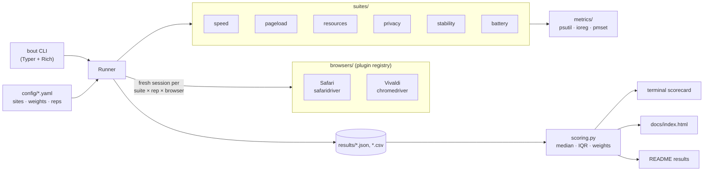

# 🥊 BrowserBout

[](https://github.com/OWNER/browserbout/actions/workflows/ci.yml)


**Automated, reproducible head-to-head browser benchmarks for macOS.**
Which browser is actually better on *my* Mac: Safari or Vivaldi? Instead of opinions, BrowserBout drives
both browsers with Selenium through the same workloads (industry benchmarks, real websites, memory and CPU,
privacy, stability under stress and battery drain), then scores them and declares a winner.

<!-- BOUT:START -->
_No published results yet. Run `bout run --full` to generate them._
<!-- BOUT:END -->

## What gets measured

| Category | How | Metrics |
|---|---|---|
| **Speed** | [Speedometer 3.1](https://browserbench.org/Speedometer3.1/), [JetStream 2.2](https://browserbench.org/JetStream2.2/), [MotionMark 1.3](https://browserbench.org/MotionMark1.3/) run to completion | benchmark scores ↑ |
| **Page loads** | Real sites ([`config/sites.yaml`](config/sites.yaml): Google, YouTube, GitHub, LeetCode, …), cold cache then warm cache | TTFB, FCP, LCP, DOMContentLoaded, load ↓ |
| **Resource usage** | Whole process tree (browser + renderers + GPU/network helpers) idle and with N site tabs | RAM (USS), CPU, RAM per tab ↓ |
| **Privacy** | Requests to known tracker domains on real sites, plus a local fingerprinting probe page | tracker requests, third-party domains, fingerprinting surfaces, visible fonts ↓ |
| **Stability** | Many heavy tabs for a long session: scroll, probe and reload every tab in a loop | crashes, hangs, p95 responsiveness, tab-open time, memory growth ↓ |
| **Battery** | Unplugged: loop muted 4K video + browsing for 30 min per browser | mAh/hour ↓, average watts, estimated battery life |

### How the verdict works

1. Each test repeats (`--full`: 3–5×). Results are reported as **median ± half the IQR**, and **launch order
   alternates** each repetition (A,B → B,A) to cancel out thermal and network drift.
2. Per-site metrics are only compared over sites **both** browsers loaded successfully.
3. Within each metric the best browser gets **100** and the others get their ratio to it. A small *noise floor*
   per metric keeps "0.1% vs 0.5% idle CPU" from looking like a 5× difference.
4. **Category score** = mean of its metrics → **per-category winner**.
5. **Overall score** = weighted mean of category scores, using weights in
   [`config/weights.yaml`](config/weights.yaml). Disagree with the weights? Change them and run `bout report` to
   re-score without re-running anything.

### Fairness rules

- Both browsers run with **clean default profiles** (Safari's isolated automation session; a fresh temporary
  profile for Vivaldi). No extensions, no history, the same window size.
- A fresh browser launch for every test and repetition, with a cooldown between launches.
- `caffeinate` keeps the Mac awake. `bout doctor` warns about Low Power Mode, a busy CPU, the power adapter,
  and other WebKit apps whose processes would count towards Safari.

## Quick start

Requirements: macOS, Python 3.11+, Safari and [Vivaldi](https://vivaldi.com) in `/Applications`.

```bash
git clone https://github.com/OWNER/browserbout && cd browserbout
python3 -m venv .venv && source .venv/bin/activate
pip install -e ".[dev]"

# One-time Safari setup
sudo safaridriver --enable
# Safari → Settings → Advanced → "Show features for web developers",
# then Develop → "Allow Remote Automation"

bout doctor          # checks that everything is ready
```

Quit Safari and Vivaldi, then:

```bash
bout run             # quick run (~15 min): 1 rep, 5 sites, no battery test
bout run --full      # full run (~2–3 h): unplugged, overnight, everything incl. battery
bout run --suite speed,pageload --browsers safari,vivaldi
bout report          # re-score the latest run (e.g. after changing weights)
bout list            # available browsers and suites
```

Every run writes:

- `results/<run-id>.json` and `.csv`: every raw measurement (partial results are saved as it goes, so a crash or
  Ctrl-C mid-run doesn't lose data)
- a **terminal scorecard**
- `docs/index.html`: a self-contained **dashboard** (enable GitHub Pages on `main` → `/docs` to publish it)
- the **results section of this README**, between the `BOUT` markers

> For the first Vivaldi run, BrowserBout downloads a chromedriver that matches Vivaldi's Chromium version. Vivaldi
> reports its own version number (8.x), so the Chromium build is read from the app bundle. To use your own
> driver, set `BOUT_CHROMEDRIVER=/path/to/chromedriver`.

## Architecture



```
src/browserbout/
  browsers/   Browser ABC + Safari, Vivaldi, registry      → add a browser here
  suites/     Suite ABC + one module per category          → add a test here
  metrics/    process-tree memory/CPU, battery, machine info
  scoring.py  medians, per-site aggregation, normalisation, weights
  runner.py   interleaved execution, error capture, crash-safe saves
  report/     terminal table, JSON/CSV, README injector, HTML dashboard
```

## Adding a browser

Chrome, Brave, Edge, Arc and Firefox can all be added with one small class. See
[CONTRIBUTING.md](CONTRIBUTING.md). Then run `bout run --browsers safari,vivaldi,chrome`.

## Limitations

- **Safari's processes are shared.** WebKit content processes are system XPC services, so Safari's memory and
  CPU count every `com.apple.WebKit.*` process. Quit Mail, App Store and other WebKit apps first (`bout doctor`
  checks this).
- **Tracker counting uses Resource Timing.** Requests made inside cross-origin iframes aren't visible, and
  pages with more than 250 resources are truncated. Both limits apply equally to every browser.
- **Battery numbers depend on screen brightness and background activity.** Use the same brightness for
  every run and keep the Mac idle otherwise.
- **Real websites change**, so compare runs made close together. The run history in the dashboard helps.

## License

MIT. Benchmarks are © their respective authors at [browserbench.org](https://browserbench.org).
